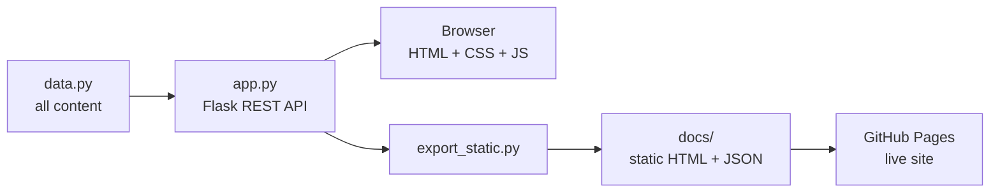

<p align="center">
  
</p>

<h3 align="center">Portfolio &amp; interactive resume</h3>

<p align="center">
  Associate Consultant &nbsp;·&nbsp; Custom Application Developer &nbsp;·&nbsp; Forensic Technology<br>
  <sub>Building scalable enterprise applications, intelligent automation and AI-enabled solutions that solve real operational challenges.</sub>
</p>

<p align="center">
  <a href="https://karthikb18.github.io/developer-portfolio/"></a>
  <a href="https://karthikb18.github.io/developer-portfolio/resume.html"></a>
  <a href="https://www.linkedin.com/in/karthik-18k/"></a>
</p>

<p align="center">
  
  
  
  
  
  
</p>

---

## Contents

- [Overview](#overview)
- [What's on the site](#whats-on-the-site)
- [Highlights](#highlights)
- [How it works](#how-it-works)
- [Tech stack](#tech-stack)
- [Project structure](#project-structure)
- [Run it locally](#run-it-locally)
- [Update the content](#update-the-content)
- [Publish on GitHub Pages](#publish-on-github-pages)
- [REST API](#rest-api)
- [Design language](#design-language)
- [Accessibility, performance and privacy](#accessibility-performance-and-privacy)
- [Credits](#credits)

---

## Overview

This repository holds my personal portfolio. It also works as an **interactive resume**: one set of content powers the website, a printable resume and a case-study page for every project.

It is built with the tools I use every day, **Python and Flask** for the backend and plain **HTML, CSS and JavaScript** for the frontend. There is no database, no frontend framework and no build tooling. All content lives in one Python file, so updating the site means editing text, not code.

> **In short:** edit `data.py` → preview with Flask → export → publish on GitHub Pages for free.

---

## What's on the site

| # | Section | What a visitor finds |
|:-:|---|---|
| 00 | **Hero** | Name, role, location, years of experience and a short tagline |
| 01 | **Let me introduce myself** | Who I am and the technical areas I focus on |
| 02 | **Impact** | The headline results of my work, with animated counters |
| 03 | **Experience** | Career timeline at KPMG Global Services and FISDOM, with expandable details |
| 04 | **Selected work** | 13 projects, each with its own case study |
| 05 | **Skills** | Grouped by area and labelled by how each skill was used |
| 06 | **Certifications** | Professional badges, workshops and learning programs |
| 07 | **Recognition** | Awards and appreciation |
| 08 | **Education** | Degree, pre-university and languages |
| 09 | **Early work** | Internship plus academic and personal projects |
| 10 | **How I work** | My six-step way of delivering |
| 11 | **Beyond the keyboard** | Biking, gaming, diecast collecting, and the people side of me |
| 12 | **Let's talk** | Ways to get in touch |

Two more page types sit alongside the homepage:

- **Interactive resume**: an ATS-friendly resume with a Compact/Detailed switch and a **Save as PDF** button.
- **Case studies**: one page per project covering the challenge, my role, the work, the stack and the outcome.

---

## Highlights

| Feature | What it does |
|---|---|
| **Experience counter** | Works out my years of experience from the visitor's date, so the site never goes out of date. It might read *nearly 5 years*, *5+ years* or *5.5 years* depending on the day it is opened. |
| **Recruiter view** | Switches between a quick **Compact** summary and the full **Detailed** view. The choice is remembered. |
| **Skill highlight** | Click any skill to light up every role and project where it was used. |
| **Project filters** | Filter work by Python, AI, Automation, RelativityOne, Azure, Data Processing or Testing. |
| **Save as PDF** | The resume has its own A4 print layout. |
| **Light and dark themes** | Follows the visitor's system setting, with a toggle in the header. |
| **Considered motion** | Scroll reveals, a reading-progress bar, a stretching wordmark and a "View" cursor on projects. All of it switches off when the visitor prefers reduced motion. |
| **Mobile first** | Tested from 320 px phones to wide desktop screens, with no sideways scrolling. |

---

## How it works



1. **`data.py`** stores every piece of content as plain Python data.
2. **`app.py`** (Flask) serves the page shells and a small read-only **REST API** built from that data.
3. **JavaScript in the browser** calls the API and renders each section, then adds the interactions.
4. **`export_static.py`** saves the same pages, plus every API response as a JSON file, into `docs/`. The published site therefore needs no server and runs free on GitHub Pages.

---

## Tech stack

| Layer | Tools |
|---|---|
| Backend | Python, Flask, Jinja templates |
| Frontend | Semantic HTML5, modern CSS (custom properties, grid, `clamp()`), vanilla JavaScript ES modules |
| Data | One Python file, served as JSON |
| Hosting | GitHub Pages (static export) or any Python host |
| Fonts | Self-hosted Bricolage Grotesque, Geist, Geist Mono and Mr Dafoe |

---

## Project structure

```text
├── app.py               Flask app: REST API, page routes, security headers
├── data.py              all portfolio content (edit this)
├── export_static.py     builds the static site into docs/
├── requirements.txt
├── templates/           page shells: SEO tags, navigation, footer
│   ├── base.html
│   ├── index.html
│   ├── resume.html
│   ├── project.html
│   └── error.html
├── static/
│   ├── css/site.css     themes, layout, motion, print styles
│   ├── js/              rendering and interactions (ES modules)
│   ├── fonts/           self-hosted web fonts
│   └── favicon.svg
├── docs/                generated static site published to GitHub Pages
├── content/my_data.md   original source notes for the content
└── CONTENT_REVIEW.md    checklist of details to confirm before publishing
```

---

## Run it locally

You need **Python 3.10 or newer**.

```bash
pip install -r requirements.txt
python app.py
```

Then open **http://127.0.0.1:5000**.

| Page | Address |
|---|---|
| Portfolio | `/` |
| Interactive resume | `/resume` |
| A case study | `/projects/<project-slug>` |

> Set `FLASK_DEBUG=1` to auto-reload while you edit, and `PORT` to use a different port. The built-in server is for development only.

---

## Update the content

Everything a visitor reads comes from **`data.py`**. Edit it, restart `python app.py` and refresh the page.

| Block in `data.py` | What it controls |
|---|---|
| `CONTACT` | Public links (LinkedIn, GitHub). Leave a value as `""` to hide that button. |
| `PERSON` | Name, headline, tagline, introduction, focus areas and languages |
| `PERSON["career_start"]` | First month of work (`"YYYY-MM"`), used by the experience counter |
| `IMPACT` | The headline numbers |
| `EXPERIENCE` | Roles, responsibilities and outcomes |
| `PROJECTS` | Projects and their case-study content |
| `SKILLS` | Skill groups and how each skill was used |
| `CERTIFICATIONS`, `RECOGNITION`, `EDUCATION` | Credentials, awards and education |
| `INTERNSHIP`, `ACADEMIC_PROJECTS` | Early work |
| `APPROACH` | The "How I work" steps |
| `BEYOND_WORK` | Life outside work |
| `SITE_URL` | The public address, used for canonical links and the sitemap |

### The experience counter

Write `{{experience}}` or `{{Experience}}` anywhere in the `PERSON` text and the site fills in the right wording for the day it is opened:

| Visitor opens the site in | It reads |
|---|---|
| December 2026 | nearly 5 years |
| January 2027 | 5 years |
| February 2027 | 5+ years |
| July 2027 | 5.5 years |
| January 2028 | 6 years |

### Certifications

Add `issuer`, `date`, `credential_id` or `verify_url` to any certification and it appears automatically. A **Verify credential** link only shows when `verify_url` is set.

---

## Publish on GitHub Pages

GitHub Pages serves static files only, so the site is exported first.

1. In `data.py`, set `SITE_URL = "https://karthikb18.github.io/developer-portfolio"`.
2. Export the site:

   ```bash
   python export_static.py
   ```

3. Commit and push the project, including the `docs/` folder.
4. On GitHub open **Settings → Pages**, choose **Deploy from a branch**, and select the **`/docs`** folder.
5. About a minute later the site is live at **https://karthikb18.github.io/developer-portfolio/**.

Re-run `python export_static.py` and push whenever you change the content or design.

> **Preview the exported site:** `python -m http.server -d docs 8000`, then open http://localhost:8000. Opening the HTML files straight from disk does not work, because browsers block them from loading the JSON data.

The Flask app can also run on any Python host as a standard WSGI app (`app:app`), for example with `gunicorn app:app`.

---

## REST API

Every endpoint is read-only (`GET`) and returns JSON.

| Endpoint | Returns |
|---|---|
| `/api/profile` | Name, headline, introduction, focus areas, languages |
| `/api/links` | Public profile links |
| `/api/impact` | Headline metrics |
| `/api/experience` | Roles, responsibilities, outcomes and related projects |
| `/api/projects` | All projects; add `?filter=python` (or another focus area) to narrow the list |
| `/api/projects/<slug>` | One case study, with links to the previous and next project |
| `/api/skills` | Skill groups with evidence levels |
| `/api/certifications` | Badges and workshops |
| `/api/recognition` | Awards and appreciation |
| `/api/education` | Education, internship and academic projects |
| `/api/approach` | The "How I work" steps |
| `/api/beyond` | Life beyond work |
| `/api/meta` | Shared notes and filter names |

---

## Design language

An editorial, print-inspired look: warm paper, black ink and one bright accent.

| Role | Light | Dark |
|---|---|---|
| Background | `#EFEDE8` | `#111111` |
| Text | `#131313` | `#EEEBE4` |
| Accent | `#FF4D1C` | `#FF5E33` |

| Typeface | Used for |
|---|---|
| **Bricolage Grotesque** (condensed, extra bold) | The large wordmark, section titles and project names |
| **Geist** | Body text |
| **Geist Mono** | Small uppercase labels such as `ROLE/` and `BASED/` |
| **Mr Dafoe** | The handwritten accents |

---

## Accessibility, performance and privacy

- **Accessible:** semantic landmarks, a skip link, visible focus states, a keyboard-friendly menu with Escape support, and screen-reader announcements for filters and view changes.
- **Comfortable:** respects reduced-motion and dark-mode preferences from the first visit.
- **Fast and self-contained:** no third-party scripts, trackers or external requests. The fonts are self-hosted.
- **Secure by default:** a strict Content Security Policy with no inline scripts, and every piece of rendered text is HTML-escaped.
- **Private:** no email address or phone number is published. Visitors reach me through LinkedIn.
- **Confidential:** some project details are summarized or anonymized to protect confidential and proprietary information.

---

## Credits

- Fonts: [Bricolage Grotesque](https://fonts.google.com/specimen/Bricolage+Grotesque), [Geist and Geist Mono](https://vercel.com/font) and [Mr Dafoe](https://fonts.google.com/specimen/Mr+Dafoe), all under the SIL Open Font License.
- Layout inspired by the editorial portfolio style of [stephanewillems.be](https://www.stephanewillems.be/).

<br>

<p align="center">
  <sub>Designed and built by <b>Karthik B</b> · Bengaluru, India</sub><br>
  <a href="https://www.linkedin.com/in/karthik-18k/"><sub>linkedin.com/in/karthik-18k</sub></a>
</p>
